<p align="center">
  
</p>

<h1 align="center">benchy-mcp</h1>

<p align="center"><em>An agent workbench for time-series analytics over the data you already have.<br>
The agent explores with SQL and takes small answers from big data.</em></p>

---

benchy-mcp is an [MCP](https://modelcontextprotocol.io) server that does one job, as fast and as
efficiently as it can: it loads time-series data into a private DuckDB workspace before the
agent's first call. The sources are ClickHouse and HTTP (both built in), plus
a folder of files and a small connector program for anything else; the one sink is DuckDB. The
agent asks `describe` what is there, writes SQL, and gets back answers capped to a few kilobytes,
however many rows sit underneath.

> **Work in progress prototype — expect frequent breaking changes.** Benchy is under heavy
> development and is not ready for production. CLI options, configuration, MCP tools, host and
> connector protocols, and result formats may change or disappear without backward compatibility.
> Pin a version or commit when experimenting, and expect to update your integrations as development continues.
>
> Available under the [MIT license](LICENSE), as [native bundles](#bundles), a [Docker image](#docker),
> or [source](#build-from-source). Benchy has not been independently security-audited,
> and on macOS it runs without an OS sandbox (see [Limits](#limits)).

**Contents:** [One call to understand the data](#one-call-to-understand-the-data) ·
[Quickstart](#quickstart) · [Efficient by design](#efficient-by-design) ·
[Origin-blind](#origin-blind) · [Your data](#your-data) · [Contained](#contained) ·
[Install](#install) · [Reference](#reference) · [Limits](#limits)

## One call to understand the data

A year of public smart-meter data: 24 meters, a reading every 15 minutes, 840,960 rows, every
quirk left in. The agent's first call is `describe`, and this is the whole answer:

```
Tables on the bench. SQL is DuckDB. The data is already loaded — file and network functions are unavailable and will be refused.

readings (840960 rows)
  ts timestamptz, meter varchar, kw double
  time column ts (looks like it): 2014-01-01 00:00:00+00 to 2014-12-31 23:45:00+00; most series have a row every 15 minutes
  series key meter (looks like it): 24 series ('MT_002' … 'MT_347')
  every series has a row every 15 minutes from its first to its last, none missing or repeated; all span the whole range
  kw: 0 to 607.029, never null; 0 in 60639 rows
  at the same moment in every series:
    kw is 0 in every series at 2014-03-30 01:00:00+00 to 01:45:00+00 (4 times) — 2014-03-30, the last Sunday of March, when clocks in the EU go forward an hour
    kw summed over the series is 2× the same time a day before and after at 2014-10-26 01:00:00+00 to 01:45:00+00 (4 times) — 2014-10-26, the last Sunday of October, when clocks in the EU go back an hour
  series with something to note (a run of 0 or null lasting 1 day or more, or of one value as long and 10× the series' average run; a gap, a repeated time, a late start or early end):
    'MT_223': kw is 0 in every row
    'MT_347': kw is 0 from the start (2014-01-01 00:00:00+00) to 2014-02-28 09:15:00+00 (58 days 9 hours), then 0 from 2014-08-06 16:15:00+00 to 2014-08-12 15:15:00+00 (5 days 23 hours), then … then 0 from 2014-12-18 13:00:00+00 to the end (2014-12-31 23:45:00+00) (13 days 11 hours), 5 runs in all
    'MT_109': kw is 0 from the start (2014-01-01 00:00:00+00) to 2014-02-18 00:00:00+00 (48 days)
    'MT_106': kw is 0 from the start (2014-01-01 00:00:00+00) to 2014-01-14 00:00:00+00 (13 days)
    the other 20 series: none of these
```

Before writing a query, the agent knows which column is time and which tells the series apart,
that `MT_223` reads 0 all year, that three meters read 0 for two weeks or more from New Year, that `MT_347`
stops for good on 18 December, and that the two clock-change hours are artefacts of recording,
not an outage and a peak.

The profile is computed once, while the data loads, so `describe` itself takes about a
millisecond (measured up to five million rows). Guesses say "looks like"; a config can state the time column and series key
instead. Units are never guessed. Values are shown as SQL literals (`'MT_223'`), which is what
the agent types to filter on them. [REQ-14](REQUIREMENTS.md#req-14--describe-tells-the-shape-of-the-data)
has the rules and the measurements.

## Quickstart

```sh
curl -fsSL https://github.com/comino/benchy-mcp/releases/download/v0.3.1/install.sh -o install-benchy.sh
BENCHY_VERSION=0.3.1 sh install-benchy.sh
claude mcp add benchy -- "$HOME/.local/bin/benchy-mcp" "$HOME/.local/lib/benchy-mcp/0.3.1/example-data"
```

That registers benchy with Claude Code, serving the small example folder (on macOS, add
`--allow-unsandboxed` at the end; see [Limits](#limits)). Ask:

> *"How much energy did each meter use, and which answer should I not trust?"*

`describe` answers the second half before any query is written. Its part about `meters`:

```
meters (8 rows)
  observed_at timestamptz, meter varchar, power_kw double
  time column observed_at (looks like it): 2026-01-01 00:00:00+00 to 2026-01-01 00:45:00+00; most series have a row every 15 minutes
  series key meter (looks like it): 2 series ('lab', 'office')
  1 of 2 series has a row every 15 minutes from its first to its last, none missing or repeated
  power_kw: 1 to 8, never null
  series with something to note (a run of 0 or null lasting 1 day or more, or of one value as long and 10× the series' average run; a gap, a repeated time, a late start or early end):
    'office': power_kw is 1 in every row; 1 gap, 1 row missing in all; the longest 15 minutes (no rows after 2026-01-01 00:15:00+00 until 2026-01-01 00:45:00+00); 1 row repeats a time already present
    the one other series: none of these
```

To serve your own data, give a folder of your own instead. Every `.csv`, `.tsv`, `.parquet`,
`.json`, `.ndjson` and `.jsonl` file at its top level, dotfiles aside, becomes a table named after
its file: no config, no schema. Other clients are under [Use it with…](#use-it-with).

## Efficient by design

- **No load tool.** Everything is loaded before the agent's first call, so the agent never spends
  a step loading, and a load never sits in its context.
- **Small answers.** Results are capped (200 rows and 8 KB by default) and say when they were
  cut. A long result can be paged by id without running the query again.
- **The agent's own tables persist** between calls, so it can build up an analysis step by step.
- **Streams are written as they arrive.** Rows from ClickHouse or a connector go into their table
  a batch at a time, so a loader never holds a stream whole: 10,000,000 rows from ClickHouse
  peak at 120 MB in the loader and take 5.2 s of CPU, where they took 940 MB and 12.6 s when a
  stream was collected first; the same rows from Parquet take 120 MB and 5.2 s, and from CSV
  484 MB and 12.0 s, its stage held to 256 MiB of memory and spilled to disk past it.
- **Measured costs.** On a 4-core ARM machine, 840,960 meter rows from a ClickHouse server on the
  same machine took 0.62 s of CPU and 0.65 s from start to the first `describe`, and moved
  2.1 MB with zstd compression (on loopback the default is none, which costs both ends less CPU:
  0.61 s and 0.56 s). 5,000,000 CSV rows loaded in 3.3 s with a session peak of 463 MB, profile
  included, on a machine with other work on it, and a `GROUP BY` over them took 66 ms, round
  trip.
  [docs/CAPACITY.md](docs/CAPACITY.md) has the method and the caveats; run
  [`examples/capacity.py`](examples/capacity.py) on your own hardware.
- **Ingest is measured stage by stage.** [`bench/ingest.py`](bench/ingest.py) loads the same
  table from CSV, Parquet, NDJSON, a connector, ClickHouse and a host's attach, and reports the
  instructions, CPU time and peak memory of every process and every stage of the load.
  [docs/PERFORMANCE.md](docs/PERFORMANCE.md) has the baseline and where the time goes.

**Does it save an agent work?** [`eval/`](eval/) asks the same model thirteen questions about
the meter data above, three times each, once with benchy and once with a jailed shell and the
DuckDB CLI over the same data, each surface with a paragraph of guidance of the same kind.
Measured on 2026-10-11, on a build from before the public history began (DuckDB 1.5.5), at
temperature 0; what the agent sees on this data — the instructions, the tools, `describe` and
every task's ground truth — was byte for byte as an earlier pre-public revision left it:

| model | steps with benchy | steps with a shell | fewer | input tokens, benchy / shell | answers matching the ground truth, benchy / shell |
|---|---:|---:|---:|---|---|
| deepseek-v4-flash-0731 | 151 | 267 | 43% | 540k / 669k | 39 / 39, of 39 |
| gemini-3.8-flash | 186 | 360 | 48% | 410k / 917k | 39 / 39, of 39 |
| gpt-5-mini | 126 | 215 | 41% | 155k / 223k | 39 / 37, of 39 |
| claude-haiku-4.5 | 138 | 224 | 38% | 278k / 412k | 36 / 36, of 39 |

Read it with its caveat: `describe` now names the answer to five of the questions outright — the
dead meter, the late starter, the one that stops, the two clock changes — which no single shell
command does (`SUMMARIZE` gives each column's range, not runs of zero per series). On the other
eight, which have to be computed, benchy still took 34–46% fewer steps, much of it because the shell
spends its first calls profiling the data that `describe` has already profiled. The three repeats of
one model and surface differed by at most 15 steps in all. With a shell, gemini-3.8-flash spent up
to 25 steps of the first question looking around the machine for its files; the jail held. The
answers were no better or worse: each model missed the same questions either way, except gpt-5-mini
leaving out the year's last interval twice with the shell. The whole run cost $2.50 on OpenRouter.

On the eleven questions both runs share, claude-haiku-4.5 and gpt-5-mini took 150 and 153 steps with
the version measured on 2026-09-30 and 120 and 107 now, while the shell's count stayed put (195 and
184, now 194 and 184). [eval/REPORT.md](eval/REPORT.md) has every task, the spread, the costs and
the traps; the earlier results are kept in
[`eval/results/archive/`](eval/results/archive/2026-09-30/). The run is one command to repeat on
your own models.

## Origin-blind

The agent sees tables, never sources. The same rows give the same table, the same column types,
the same `describe` and the same answers, whether they came from a CSV file, a Parquet file, a
connector or ClickHouse. Every integer is `BIGINT`, every float `DOUBLE`, every timestamp
`TIMESTAMP WITH TIME ZONE` (a zone-less one is read as UTC unless its source names a zone). Every
table is written to its file the same way, so not even `pragma_storage_info` tells them apart.
File paths, connector names and why a source failed to load go to the operator's log on stderr,
never to the agent. What a source fetches (a time window, a list of entities, some columns) is
set by the operator or the host, never by the model. The agent always writes DuckDB SQL.

## Your data

**ClickHouse** and **HTTP** are built in.
A folder of files and an exec connector cover the rest. Whatever the source, it lands in DuckDB.

**A folder.** `benchy-mcp /path/to/data` reads the folder's top level; subdirectories, hidden
files (any name starting with `.`, such as macOS's `._meters.csv`) and other kinds of file are
skipped and named in the log. A table is named after its file, lower-cased,
with `_`, `-`, `.` and spaces turned into `_` and other characters dropped: `Sales Q1.csv` is
`sales_q1`, and `2026-data.parquet` is `t_2026_data`. Two files with the same name stop startup;
`--source name=path` names a file yourself, a hidden one too.

**ClickHouse.** Name the tables in a config file:

```toml
[[source]]
type = "clickhouse"
url = "http://localhost:8123"
tables = ["readings", "meters"]      # each becomes a table of the same name
env = { CLICKHOUSE_USER = "${CH_USER}", CLICKHOUSE_PASSWORD = "${CH_PASSWORD}" }
  [source.narrow]                    # optional: only the last 30 days
  column = "ts"
  last = "30d"
```

```sh
benchy-mcp check benchy.toml readings    # reach, sign in, schema, estimate, one row
benchy-mcp --config benchy.toml
```

benchy reads the schema, maps it to the bench's types, pushes the time window down as query
parameters, and estimates the load before a row is sent. [docs/SOURCES.md](docs/SOURCES.md) has
the fields, the type mapping and the errors.

**HTTP.** A URL that answers with Arrow IPC, Parquet, CSV or NDJSON, gzip- or zstd-compressed,
or a JSON API that answers in pages:

```toml
[[source]]
name = "readings"
type = "http"
url = "https://api.example.com/v1/readings"
format = "json"                      # or "arrow", "parquet", "csv", "ndjson"
env = { KEY = "${API_KEY}" }
auth = { header = "X-Api-Key", env = "KEY" }
  [source.pages]                     # {"data": [...], "meta": {"next_cursor": "..."}}
  rows = "data"
  next = "cursor"
  cursor = "meta.next_cursor"
  cursor_param = "cursor"
```

Each format takes its fastest path into DuckDB: CSV and NDJSON are spooled to a file and read by
DuckDB's own readers, exactly as the same file is read, Parquet is staged and read, Arrow goes
batch by batch, and JSON pages are decoded straight into batches. So an HTTP table is the file's
table, types and storage layout included. `benchy-mcp check` shows the request (the secret
masked), the first page's rows and the schema to pin. [docs/SOURCES.md](docs/SOURCES.md#http) has
the fields; [docs/HTTP-SOURCE.md](docs/HTTP-SOURCE.md) the design and its measurements.

**Anything else: a connector.** A connector is any program that writes an Arrow stream to
stdout. [`hello.sh`](examples/connectors/hello.sh) is a complete one in shell;
[`meters.py`](examples/connectors/meters.py) is a realistic one to copy. You declare its schema
in the config, and a stream that does not match is refused. `benchy-mcp exec-test` checks one
without a server or a model. [docs/EXEC-CONNECTOR-PROTOCOL.md](docs/EXEC-CONNECTOR-PROTOCOL.md)
is the contract; [`examples/benchy.toml`](examples/benchy.toml) documents the config inline.

**Embedded in a platform.** `benchy-mcp host` speaks a small framed protocol instead of MCP, so
an agent platform can attach Arrow streams mid-session and relay the agent's SQL. A host that
fetches data itself streams it through a pipe it passes with the request, or, where it cannot
pass a descriptor (Node.js, Java), through a stream channel, one more pipe benchy inherits, into
which it writes its streams back to back; nothing is spooled to a file on either side, and the
load runs while the fetch arrives. A host can state a table's
time column and series key, as an operator's config can, lower the session's limits (the
operator sets them, and may raise them past the defaults), and give the agent's tools its own
names, which every text benchy writes for the agent then uses.
[docs/HOST-PROTOCOL.md](docs/HOST-PROTOCOL.md) is the contract;
[`examples/host.py`](examples/host.py) is a complete host in standard-library Python, and
[`examples/host-node.mjs`](examples/host-node.mjs) one on Node.js that streams through the
channel.

A source that fails to load costs only its own table: the session starts with the rest, and
`describe` lists that table as not available.

**SQL helpers.** An operator, or an integrator deploying benchy for a host, can give the agent
views and macros of its own, which it calls like built-ins: a `daily` view, `dewpoint(t, rh)`,
`hours_of(start_at, end_at)`. They go in the config, for a server and for `host --config`
alike, and are fixed for the session; no tool or protocol call adds one:

```toml
[helpers]
file = "helpers.sql"     # CREATE VIEW and CREATE MACRO statements; or `sql = """…"""` inline
```

`describe` lists each with its signature and the `--` comment above it. The agent cannot drop,
change or shadow one, nor give anything of its own the name of a table a helper reads, and a
helper named like a built-in or a word DuckDB's parser reads itself, or one that reads a file
or names a table in a string (`query_table('readings')`), stops startup. **A helper macro reads
no table**: DuckDB expands a macro inside the caller's query, where a CTE of the caller's named
like the table would stand in for it, so a macro whose body reads one stops startup too, and
what reads a table is written as a view the agent filters. A macro computes from its arguments,
with `range`, `generate_series`, `unnest` or VALUES for a table macro, and **calls only DuckDB's
functions and other helpers**, each by its name alone: DuckDB binds part of a macro's body only
where it is called, where a macro the agent made under a name nothing had (or in a schema of its
own, for `s.f(x)` or `x.f()`) would answer for it, so a macro that calls anything else stops
startup. A view over a table a host has not attached yet says so until it is.
[`examples/helpers.sql`](examples/helpers.sql) has four for the bundled data, and
[REQ-18](REQUIREMENTS.md#req-18--helpers-the-operator-provides) the rules.

## Contained

- **A sealed engine.** DuckDB's file and network access, extensions and settings are switched off
  and locked before any data arrives, and a statement allowlist keeps them locked. `read_csv`,
  `ATTACH`, `COPY … TO` and `INSTALL` are refused. Loaded tables are read-only.
- **No credentials in the engine.** Each connector, and each ClickHouse or HTTP fetch, runs in a
  process of its own that holds only its own source's credentials.
- **Isolated sessions.** Each session is its own set of processes. No tool parameter can name a
  path, a session or a database, so there is nothing to guess. Nothing outlives the session.
- **Landlock on Linux.** The engine, every file parser and the ClickHouse and HTTP loaders are
  confined by the kernel to what they need, so even a compromised engine cannot reach the rest of your files.
  From Linux 6.7 they are kept off the network too, but for a loader's own source's ports.
- **Survivable failure.** A runaway query is stopped at its deadline and costs that query, not the
  session.



It is SQL rather than Python for this reason: arbitrary Python is arbitrary code execution, a far
harder box to build. SQL over DuckDB keeps window functions, `ASOF` joins, quantiles and
regression. [REQUIREMENTS.md](REQUIREMENTS.md) states each guarantee and the tests that prove
it; [Limits](#limits) says where they stop.

## Install

benchy runs on Linux (x86_64, aarch64) and macOS (Apple silicon, Intel). On Linux, Landlock
confines the engine. macOS has no equivalent wired up, so there benchy refuses to serve until you
pass `--allow-unsandboxed`, and the SQL layer is the only boundary.

### Build from source

You need rustup and Python 3: `rust-toolchain.toml` pins the compiler (Rust 1.98.1), and rustup
fetches it on the first build.

```sh
git clone https://github.com/comino/benchy-mcp && cd benchy-mcp
python3 packaging/duckdb_lib.py fetch    # DuckDB's library, checked against its SHA-256
cargo build --release
./target/release/benchy-mcp doctor
```

The first build takes several minutes. It downloads DuckDB's official release library for your
platform, about 40 MB with Parquet, JSON and time-zone support built in, into `target/`, and links
against it. The `fetch` line checks that file against the SHA-256 pinned in
`packaging/duckdb.sha256` first; without it, the build downloads it unchecked. To link a copy of
your own instead, set `DUCKDB_LIB_DIR` and `DUCKDB_INCLUDE_DIR`.
Serving data never downloads anything.

**Register the binary you built by its absolute path**, and keep the clone where it is. The
binary loads DuckDB's library from `target/duckdb-download/` in that clone, by absolute path, or
from its own directory. Moving or deleting the clone, or `cargo clean`, leaves it unable to start.

```sh
claude mcp add benchy -- /home/you/benchy-mcp/target/release/benchy-mcp /home/you/data
```

`cargo install --git` does not work for the same reason: it builds in a temporary directory,
copies only the binary out and deletes the rest, DuckDB's library with it. Run it from the clone, by its absolute path.

**Check it without a model.** `verify.py` drives a real MCP handshake and checks what this README
promises: loaded data cannot be changed, file, network and extension escapes are refused, and a
runaway query loses the query, not the bench. `doctor --probe` checks what the sandbox allows;
with `--json` it says so as one JSON object, a verdict and each mechanism, for a host to check
when its container starts. Without Landlock, or below its minimum ABI, the verdict is "not
enforced", so is each mechanism's own `enforced`, and the exit status is non-zero. Below ABI 4 it
is "partial", and the exit status is zero.

```sh
python3 examples/verify.py ./target/release/benchy-mcp ./examples/data
./target/release/benchy-mcp doctor --probe
./target/release/benchy-mcp doctor --probe --json
```

The JSON has these keys, and a release may add more, never rename or drop these:

| Key | |
|---|---|
| `benchy` | benchy's version |
| `engine` | `"DuckDB v1.5.5"`, the library loaded |
| `library` | the file it was loaded from, or `null` |
| `landlock_abi` | the kernel's Landlock ABI, 0 where it has none |
| `verdict` | `"enforced"`, `"partial"` (files confined, TCP not: below Landlock ABI 4) or `"not_enforced"`; the exit status is 0 for the first two and 1 for the last |
| `reason` | why it is partial or not enforced, or `null` |
| `mechanisms` | one entry each for `engine`, `file_loader` and `network_loader` |
| `mechanisms[].name` | which |
| `mechanisms[].enforced` | whether every check that counts held, and at least one counted |
| `mechanisms[].posture` | how the child said it was confined, as prose |
| `mechanisms[].checks` | each `{"check", "allowed", "must_be"}`: what was tried, whether the child could, and what it must; `must_be` is `null` where the right is not Landlock's to withhold on this kernel, and does not count |
| `mechanisms[].error` | why the probe could not run, or `null` |

Below Landlock ABI 4 (Linux 6.7) the kernel has no TCP rules: the TCP checks do not count, and
where every other one held the verdict is `"partial"` (PARTIAL in prose), with the same `reason`
as `hello`'s `sandbox_posture`. Its exit status is 0, because benchy serves there without a flag:
the filesystem boundary it relies on holds. A host that relies on the network boundary too treats
`"partial"` as a failure, or starts benchy with `--require-full-sandbox`, which refuses it.

### Bundles

Download a bundle from [Releases](https://github.com/comino/benchy-mcp/releases/tag/v0.3.1),
or use the installer in [Quickstart](#quickstart). Linux bundles need glibc 2.35 or newer
(Ubuntu 22.04 or newer); Alpine's musl is not supported. macOS bundles are not notarized:
a browser download may need approval in System Settings → Privacy & Security.

Each bundle carries the binary, DuckDB's library, licenses and example data. Keep them together;
the installer unpacks to `~/.local/lib/benchy-mcp/0.3.1/` and links `~/.local/bin/benchy-mcp`.
It checks the download's SHA-256. Inside, `SHA256SUMS` lists every file, and the README names
the DuckDB release file the library came from and the SHA-256 it was checked against before the
build. You can also verify its GitHub build attestation:

```sh
gh attestation verify benchy-mcp-linux-x86_64.tar.gz --repo comino/benchy-mcp
```

Beside each bundle, a release has its SBOM, `benchy-mcp-<platform>.cdx.json` (CycloneDX): every
crate compiled for that platform, with its Cargo.lock checksum, and DuckDB's library with the
SHA-256 of the file shipped and of the release file it came from. It is attested too:
`gh attestation verify benchy-mcp-linux-x86_64.tar.gz --repo comino/benchy-mcp --predicate-type
https://cyclonedx.org/bom`.

**Pinning a release.** `compat.json`, one per release and listed in `SHA256SUMS`, says what a
pin bump changes: the benchy and DuckDB versions, the host protocol versions it speaks, its
platforms, the oldest glibc its Linux bundles need, and the Landlock ABI the full sandbox needs:

```json
{"benchy": "0.3.1", "duckdb": "1.5.5", "host_protocols": [1, 2, 3, 4, 5, 6, 7],
 "platforms": ["linux-x86_64", "linux-aarch64", "macos-arm64", "macos-x86_64"],
 "full_sandbox_min_landlock_abi": 4, "min_glibc": "2.35"}
```

Check it in CI before you deploy. `benchy-mcp --version --json` prints the same object, less
`min_glibc`, from the binary you were handed; [docs/HOST-PROTOCOL.md](docs/HOST-PROTOCOL.md#versions)
says what each field means.

[`packaging/package.sh`](packaging/package.sh) builds a bundle locally;
[packaging/README.md](packaging/README.md) is the README inside it.

### Docker

`ghcr.io/comino/benchy-mcp:0.3.1` supports Linux amd64 and arm64, including Docker Desktop's
Linux VM on macOS and Windows. It speaks MCP over stdio: use `-i`, without `-t` or a published
port. The image runs as UID/GID `65532:65532`; mounted files must be readable by that user.

For a folder of files, mount it read-only and give the session a memory limit and writable
temporary space. This example also disables network access:

```sh
docker run --rm --init -i --read-only --cap-drop=ALL --security-opt=no-new-privileges \
  --network=none --memory=2g --memory-swap=2g --pids-limit=256 \
  --tmpfs=/tmp:rw,nosuid,nodev,size=1g \
  --mount "type=bind,src=/absolute/path/to/data,dst=/data,readonly" \
  ghcr.io/comino/benchy-mcp:0.3.1
```

Configure an MCP client with `docker` as its command and these `run` arguments. For example:

```json
{
  "mcpServers": {
    "benchy": {
      "command": "docker",
      "args": [
        "run", "--rm", "--init", "-i", "--read-only", "--cap-drop=ALL",
        "--security-opt=no-new-privileges", "--network=none",
        "--memory=2g", "--memory-swap=2g", "--pids-limit=256",
        "--tmpfs=/tmp:rw,nosuid,nodev,size=1g",
        "--mount", "type=bind,src=/absolute/path/to/data,dst=/data,readonly",
        "ghcr.io/comino/benchy-mcp:0.3.1"
      ]
    }
  }
}
```

On desktop clients, use the full path to `docker` if it is not on the app's PATH. Increase the
memory and temporary-space limits for larger loads; tmpfs usage counts toward container memory.
For ClickHouse or HTTP, omit `--network=none`, mount your configuration read-only, pass its
credential variables with `--env NAME`, and append `--config /path/in/container/benchy.toml`
after the image. Connector runtimes such as Python and Node are not included; build a derived
image when a connector needs them. Executable connectors must belong to root or the container's
user, without group/world write permissions. `COPY` in a derived image gives them root ownership;
for bind-mounted connectors, use `--user UID:GID` matching their owner. The host protocol can use
mounted files over stdio; descriptor passing and inherited stream-channel descriptors cannot
cross `docker run`.

The container uses its host's Linux kernel and Docker's default seccomp profile. Check the actual
runtime with `docker run --rm ghcr.io/comino/benchy-mcp:0.3.1 doctor --probe --json`.
If Landlock is unavailable, serving refuses to start; `--allow-unsandboxed` is an explicit opt-out
with the limitations described below. The image does not enable it automatically.

To build the current checkout: `docker build -t benchy-mcp:local .`. Pin `0.3.1` or an image
digest for integrations; `0.1` and `latest` move as new prototype releases are published.

### Use it with…

Each client starts benchy itself, so give it absolute paths. Desktop apps do not read your
shell's `PATH`: there, use the full path to the binary you built, such as
`/home/you/benchy-mcp/target/release/benchy-mcp` (`/Users/you/…` on macOS). On macOS, add
`--allow-unsandboxed` after the data folder in every example below.

**Claude Code.** Everything after `--` is the command that starts the server. `--scope user`
makes it available in every project; the default, `local`, is this project only, for you.

```sh
claude mcp add benchy -- /abs/path/to/benchy-mcp /absolute/path/to/your/data
claude mcp add --scope user benchy -- /abs/path/to/benchy-mcp /absolute/path/to/your/data
```

**Claude Desktop** (macOS and Windows; benchy runs on macOS). Settings → Developer → Edit Config
opens `~/Library/Application Support/Claude/claude_desktop_config.json`. Add the server, then
quit and restart the app:

```json
{
  "mcpServers": {
    "benchy": {
      "command": "/Users/you/benchy-mcp/target/release/benchy-mcp",
      "args": ["/Users/you/data", "--allow-unsandboxed"]
    }
  }
}
```

**Cursor.** `~/.cursor/mcp.json` for every project, or `.cursor/mcp.json` in one:

```json
{
  "mcpServers": {
    "benchy": {
      "type": "stdio",
      "command": "/home/you/benchy-mcp/target/release/benchy-mcp",
      "args": ["/home/you/data"]
    }
  }
}
```

**VS Code.** `.vscode/mcp.json` in the workspace, or the file *MCP: Open User Configuration*
opens. The top-level key is `servers`, not `mcpServers`:

```json
{
  "servers": {
    "benchy": {
      "type": "stdio",
      "command": "/home/you/benchy-mcp/target/release/benchy-mcp",
      "args": ["/home/you/data"]
    }
  }
}
```

**Any other MCP client that speaks stdio:** the command is the binary, the arguments are what you
would type after it (`<dir>`, or `--config benchy.toml`, and any [options](#options)). benchy
writes MCP on stdout and its log on stderr, and needs no environment variables.

## Reference

### Options

As `benchy-mcp --help` prints them:

```
USAGE
  benchy-mcp <dir>                    every .csv/.tsv/.parquet/.json/.ndjson/.jsonl
                                      at the top of <dir>, but no dotfile, becomes a
                                      table named after the file; what is skipped is
                                      logged on stderr
  benchy-mcp --source name=path ...   name files explicitly
  benchy-mcp --config benchy.toml     ClickHouse tables, URLs, exec connectors, per-source limits,
                                      narrowing, session budget, SQL helpers ([helpers]: views and
                                      macros the agent calls like built-ins; with <dir> too)
  benchy-mcp host                     serve the host protocol on stdio instead: the host
                                      attaches data (docs/HOST-PROTOCOL.md)
  benchy-mcp doctor [--probe] [--json]  report what this machine can enforce, and which
                                      DuckDB library this binary loaded; --json probes, and
                                      prints one JSON object for a host to check
  benchy-mcp check <cfg> <name>       check one configured source without a model: for
                                      ClickHouse reach, sign in, schema, estimate, one row;
                                      for HTTP the request, the first page, the schema to pin
  benchy-mcp exec-test <cfg> <name>   check one connector against the contract

OPTIONS
  --max-rows N        rows per result page                       (default 200)
  --max-bytes N       bytes per response, as the client gets it  (default 8192, at least 512)
  --max-cell-bytes N  bytes of one value before it is cut        (default 256)
  --deadline N        seconds per query batch                    (default 20)
  --hard-grace N      seconds past the deadline before the engine is killed (default 10)
  --memory SIZE       DuckDB's memory budget in the engine       (default 1GB)
  --memory-ceiling SIZE  the most resident memory the engine may hold, planning included;
                      past it the engine is killed and rebuilt (default --memory and half
                      again, and at least 256MiB over it); or [engine] memory_ceiling in a
                      config. A host may lower it for its session, never raise it.
                      Linux only: elsewhere it is not enforced, and not reported.
  --loader-memory-ceiling SIZE  the most resident memory one loader may hold, with the
                      connector it runs and what that starts; past it the load fails and
                      attaches nothing (default 1GB); or [loader] memory_ceiling in a config.
                      A host may lower it for its session (protocol 6), never raise it.
                      Linux only, as --memory-ceiling.
  --threads N         threads the engine runs agent SQL on      (default 1); or [engine]
                      threads in a config. One keeps a runaway to one core of a shared
                      machine; more make a grouped aggregate several times quicker on one
                      that is not. A host may lower it for its session (protocol 7), never
                      raise it.
  --load-timeout N    seconds one source may take to load       (default 300)
  --attach-rows N     with `host`: rows one attachment may hold  (default 10000000)
  --attach-bytes N    with `host`: bytes one attachment may be   (default 268435456)
  --session-rows N    with `host`: rows a session may attach     (default 50000000)
  --session-bytes N   with `host`: bytes a session may attach    (default 2147483648)
                      A host may lower each for its session, never raise it. `host --config`
                      takes a config's [attach] and [budget] tables instead, and no sources;
                      its [engine] and [helpers] too, the helpers made before the first attach
  --stream-channel FD with `host`: descriptor FD, which the host passes as one more inherited
                      pipe, is the session's stream channel: the host writes Arrow streams
                      into it back to back, and each attach with `stream: channel` takes
                      the next one. No descriptor passing, so a host on Node.js or Java can
                      stream. Off unless named: an inherited descriptor is not a channel.
  --allow-unsandboxed serve even where Landlock cannot confine the engine
  --require-full-sandbox  refuse to start unless Landlock confines the engine fully,
                      TCP included (Linux 6.7 or later); wins over --allow-unsandboxed
  --require-memory-ceilings  refuse to start unless the engine's and the loaders'
                      memory ceilings are enforced (Linux)
  --probe             with `doctor`: measure containment instead of reporting it
  --json              with `doctor`: measure it, and say so as JSON: a verdict and each mechanism;
                      with `--version`: the versions, host protocols, platforms and Landlock
                      ABI a host checks a pin against, as a release's compat.json has them
  --print-limits      with `host`: print what `hello` would report for these flags, as JSON,
                      and start nothing
  -h, --help          this
  -V, --version       benchy's version and the DuckDB library's
```

### What the agent gets

| Tool | |
|---|---|
| `describe` | every table, its row count and its columns, and the shape of its data: the time column, its range and cadence, the series key and the step each series keeps, and which series are dead, start late, stop, pause, skip or repeat rows, or hold one value far longer than they otherwise do; then the operator's helpers, each with its signature and comment |
| `query` | DuckDB SQL, several statements per call, each returning its own result. If one fails, nothing after it runs; the ones before it keep their effects, and their results come back after the error |
| `get_result` | read a result again, or further on, by id and row offset; the last 32 are kept |
| `dialect` | the DuckDB syntax reference, on demand; errors already name their fix |

### Requirements

Eighteen requirements, each proven by named tests. [REQUIREMENTS.md](REQUIREMENTS.md) lists them,
and `scripts/ci.sh` fails if one names a test that does not exist.

1. **Isolation**: one session, one process, one workspace; nothing names a path or a session.
2. **Sealed SQL**: the locked engine is the boundary; the allowlist keeps it locked.
3. **Sealed process**: on Linux, Landlock confines the engine, each file's parser, and the
   ClickHouse and HTTP loaders (their staging directory, the resolver's files, and from Linux 6.7
   their source's ports).
4. **Sources**: files, ClickHouse, HTTP and connectors, loaded before the agent's first call.
5. **Credentials stay out of the engine**: each loader holds only its own source's.
6. **Connector output is untrusted**: validated against the operator's declaration.
7. **Ceilings**: a deadline, a memory budget, a memory ceiling, and row and byte caps on every
   batch.
8. **Survivable failure**: a runaway loses the query, not the bench.
9. **Scratch is free; loaded data is not**: DuckDB itself enforces read-only, and no agent
   object can take a loaded table's or a built-in's name.
10. **Bounded results**: capped, truncation stated, fetchable again by id.
11. **Teach the dialect where it lands**: the fix is in the error.
12. **Admission control**: ask a source what a load will cost before it runs.
13. **The host protocol**: a host attaches data mid-session; a refusal changes nothing.
14. **Describe tells the shape of the data**: found once, at load.
15. **Origin-blind**: the same data looks the same from every source.
16. **ClickHouse is a built-in source**: schema mapped, narrowing pushed down, load estimated.
17. **HTTP is a built-in source**: bulk formats and paged JSON APIs, each loading as the same
    file would.
18. **Helpers the operator provides**: views and macros from the config, read-only to the agent,
    made under the engine's lock, and fixed for the session.

## Limits

- **No OS sandbox on macOS.** There, containment is the SQL layer alone, and benchy refuses to
  serve until started with `--allow-unsandboxed`, so running that way is always a choice. The
  same holds anywhere Landlock cannot confine the engine. Windows is not supported.
- **A connector is not sandboxed.** It reaches whatever it fetches from, so it runs with your
  user's rights, in a process of its own that holds only its source's credentials. Run
  connectors you would run yourself. The loaders that fetch from ClickHouse and over HTTP run
  only benchy's code, and are confined: each can reach its source's ports, but Landlock names
  ports, not hosts, so it could reach those ports on another host. Neither uses a proxy; the
  ClickHouse loader follows no redirect, and the HTTP loader only one on its source's origin or
  to a host its `redirect_hosts` names. Port rules need Linux 6.7; before it, the filesystem is
  confined and the network is not.
- **The guarantee starts at the connection.** Routing the right user to the right session is the
  host's job; benchy cannot check it.
- **A wedged or swollen query costs your scratch tables.** The server kills the engine
  `--hard-grace` seconds past the deadline, or as soon as its resident memory passes
  `--memory-ceiling`, while a query runs or as it answers (on Linux, which has the `/proc` it is read from; elsewhere `hello` reports
  the ceiling as `null` and `doctor` says it is not enforced), and starts a new one over the loaded data, without reading any source
  again. You lose that query and the tables you made, and you are told so. DuckDB's `--memory`
  bounds what DuckDB counts, and not planning, a very long string or a large ENUM type. A long
  string's overshoot grows with the rows of a vector that hold one: under `--memory 256MB`, with
  the ceiling raised out of the way, `SELECT sum(length(repeat('x', 100000000 + i))) FROM
  range(n) t(i)` peaked the engine at 141, 237, 427 and 809 MiB for 1, 2, 4 and 8 rows (DuckDB
  1.5.5, Linux aarch64). The ceiling bounds the engine process. It does not cap the parent server's input buffers or
  queued requests. Use an external limit for the whole session, such as Docker's `--memory`;
  a prototype session can otherwise exhaust its host's memory.
- **A load that grows past `--loader-memory-ceiling` fails** (default 1GB, on Linux). Each loader
  is read while it runs, with the connector it runs and anything that starts; past the ceiling it
  is killed and nothing of its table is attached, and the operator's log says so and what to do.
  The harness's 10M-row loads peak at 94–410 MB, a CSV of 300 columns at 343 MB; a connector
  that holds its data before writing it is what passes it.
- **A file is staged before it is written.** A large CSV or Parquet load peaks higher than the
  same rows from ClickHouse or a connector, which go into their table batch by batch as they
  arrive ([docs/CAPACITY.md](docs/CAPACITY.md#a-clickhouse-table-six-ways)).
- **Not audited.** Treat it as a tool you run on your own data until that changes.

## Contributing

[CONTRIBUTING.md](CONTRIBUTING.md) explains how it fits together, how to verify a change locally
(`scripts/ci.sh`), and the one rule: every fix starts from a failing test. Changes are listed in [CHANGELOG.md](CHANGELOG.md).

## Licence

MIT; see [LICENSE](LICENSE). The eval data: Artur Trindade, *ElectricityLoadDiagrams20112014*, UCI
Machine Learning Repository (2015), https://doi.org/10.24432/C58C86, CC BY 4.0, cut as
[`eval/fetch_uci.py`](eval/fetch_uci.py) describes.
